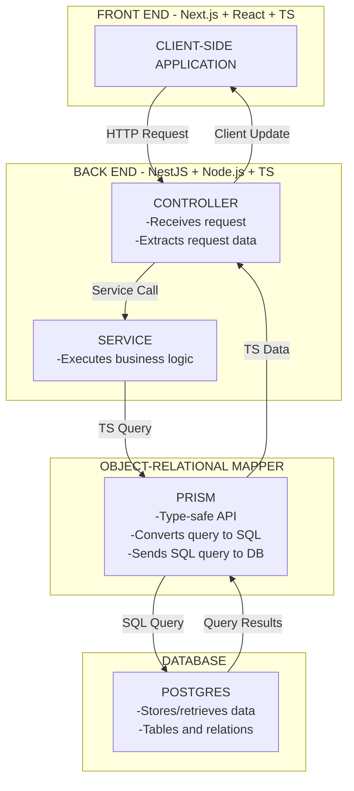
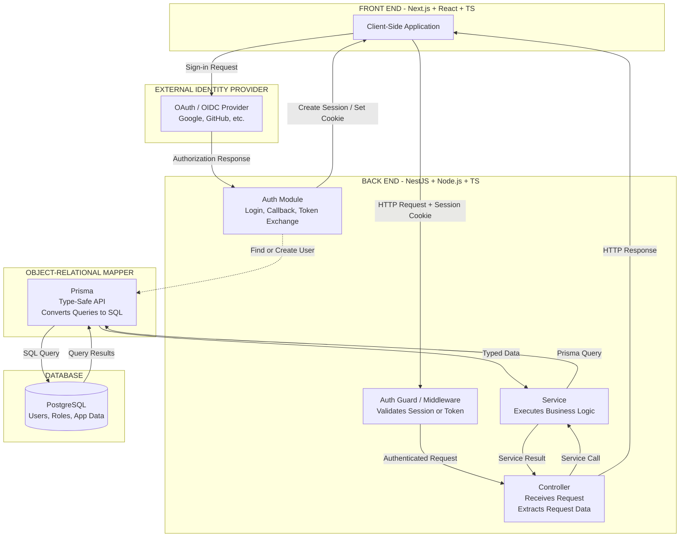

# 10-Hour Interview Prep Project: CampusOps API

__Goal:__ Build a small, production-minded, multi-tenant task-management application. Demonstrate practical skills in REST API development, database design, multi-tenant architecture, authentication, authorization, testing, and production readiness.

This project will prioritize backend engineering over frontend polish.

### Tech Stack

- __Frontend:__ Next.js, React, TypeScript
- __Backend:__ NestJS, Node.js, TypeScript
- __ORM:__ Prisma
- __Database:__ PostgreSQL
- __Testing:__ Jest
- __Validation:__ class-validator

## Project Overview

CampusOps is a task-management API for a SaaS platform serving multiple colleges.

Each college is an isolated tenant with its own users and tasks, unable to access another college's data.

### Core Features:
- Multi-tenant data model
- JWT authentication
- Role-based access control (RBAC)
- REST API for task management
- Prisma schema and database migrations
- PostgreSQL queries and indexes
- Input validation and error handling
- Unit and integration tests
- Basic Next.js frontend
- CI workflow for type checking and tests
- API Endpoints
- Method	Endpoint	Description
- POST	/v1/tasks	Create a task
- GET	/v1/tasks	List tasks for the authenticated user's tenant
- GET	/v1/tasks/:id	Retrieve a task
- PATCH	/v1/tasks/:id	Update a task
- DELETE	/v1/tasks/:id	Delete a task

The API should also support pagination and filtering by task status.

## Architecture

### Simplified:

### More Complicated (With OAuth):

### Architectural Rules
NestJS owns the backend API and database access.
Next.js calls NestJS over HTTP.
Prisma manages database queries and migrations.
Authentication identifies the current user.
Authorization determines what the user can access.
Tenant scoping is enforced in backend service logic.
API errors use consistent HTTP status codes and response formats.
1. Suggested Project Structure
campusops/
├── apps/
│   ├── web/                     # Next.js frontend
│   │   ├── app/
│   │   ├── components/
│   │   └── lib/
│   │       └── api.ts
│   │
│   └── api/                     # NestJS backend
│       └── src/
│           ├── auth/
│           ├── tenants/
│           ├── tasks/
│           ├── prisma/
│           ├── common/
│           └── main.ts
│
├── prisma/
│   └── schema.prisma
├── package.json
├── docker-compose.yml
└── README.md

Use npm workspaces or separate application directories, depending on which setup is fastest for you.

4. Database Design

Start with three core models:

Tenant: represents a college or organization.
User: belongs to a tenant and has a role.
Task: belongs to a tenant and has a status.
Example Prisma Schema
enum Role {
  ADMIN
  MEMBER
}

enum TaskStatus {
  TODO
  IN_PROGRESS
  DONE
}

model Tenant {
  id    String @id @default(cuid())
  name  String
  users User[]
  tasks Task[]
}

model User {
  id       String @id @default(cuid())
  email    String @unique
  role     Role   @default(MEMBER)
  tenantId String
  tenant   Tenant @relation(
    fields: [tenantId],
    references: [id]
  )
}

model Task {
  id        String     @id @default(cuid())
  title     String
  status    TaskStatus @default(TODO)
  tenantId  String
  tenant    Tenant     @relation(
    fields: [tenantId],
    references: [id]
  )
  createdAt DateTime   @default(now())

  @@index([tenantId, status, createdAt])
}

This is a starting point. Add fields, constraints, and relationships as needed.

Database Tasks
Create and run the initial migration.
Understand foreign keys and relational integrity.
Add appropriate indexes.
Use Prisma's query API effectively.
Learn when transactions are necessary.
Consider how tenant ownership can be enforced at the database level.

## Implementation Plan
### Hour 1: Project Setup and Data Modeling

Tasks:
- Initialize the Next.js application.
- Initialize the NestJS application.
- Configure TypeScript and environment variables.
- Start PostgreSQL locally.
- Install and configure Prisma.
- Design the initial database schema.

Deliverable: Both applications start, and the database schema is ready.

Interview topics:

Relational database design
Foreign keys and indexes
Prisma versus raw SQL
Database migration strategies
Hours 2–3: REST API and Prisma

Tasks:

Implement task CRUD endpoints in NestJS.
Create TasksController and TasksService.
Implement Prisma queries.
Add request DTOs and validation.
Implement pagination and status filtering.
Return appropriate HTTP status codes.

Deliverable: A working REST API for task management.

Interview topics:

REST API design and versioning
Controller versus service responsibilities
DTO validation
Pagination and query performance
Transactions and error handling
Hour 4: Authentication and Tenant Isolation

Tasks:

Implement JWT verification.
Create an authentication guard.
Add a mechanism for retrieving the authenticated user.
Implement basic RBAC for ADMIN and MEMBER.
Scope every task operation to the authenticated user's tenant.
Prevent cross-tenant reads, updates, and deletes.

Deliverable: Authenticated API endpoints with tenant isolation.

Interview topics:

Authentication versus authorization
JWT validation and expiration
RBAC versus ABAC
Insecure direct object references (IDOR)
Tenant isolation and PostgreSQL row-level security
Hours 5–6: Automated Testing

Tasks:

Write unit tests for service-layer business logic.
Write integration tests against a real test database.
Test successful task creation and retrieval.
Test invalid request bodies.
Test unauthenticated requests.
Test cross-tenant access attempts.
Test updates and deletes for unauthorized users.

Deliverable: A meaningful automated test suite.

Interview topics:

Unit versus integration tests
Mocking external dependencies
Test database isolation
Regression testing
Testing authorization boundaries
Hour 7: Minimal Next.js Frontend

Tasks:

Create a simple task list page.
Add a form for creating tasks.
Add basic status filtering.
Connect the frontend to the NestJS API.
Display loading, success, and error states.

Deliverable: A minimal working frontend that demonstrates the API.

Important: Keep the UI simple. Do not spend time on styling or elaborate components.

Hour 8: Production-Quality Behavior

Tasks:

Add centralized exception handling.
Standardize API error responses.
Add structured logging.
Validate environment variables.
Add a health-check endpoint.
Review pagination and database indexes.
Ensure sensitive details are not exposed in errors or logs.

Deliverable: A more robust API with clear operational behavior.

Interview topics:

Production debugging
Logging and observability
API error contracts
Performance optimization
Reliability and graceful failure
Hour 9: CI and Delivery Readiness

Tasks:

Configure GitHub Actions.
Run linting and TypeScript checks in CI.
Run automated tests.
Document local setup and environment variables.
Document how to apply migrations.
Optionally deploy to a test environment if time permits.

Deliverable: A reproducible project with automated checks.

Interview topics:

CI/CD pipelines
Safe database migrations
Environment configuration
Rollbacks and deployment strategies
Hour 10: Review and Interview Simulation

Tasks:

Review the architecture.
Fix the most important remaining bugs.
Check authorization and tenant isolation.
Rehearse explaining the request lifecycle.
Practice answering the questions below.
Make one small code change without following a tutorial.

Deliverable: A project you can confidently explain and modify.

6. Important Security Requirement: Tenant Isolation

Never trust a client-supplied tenant ID to determine what data the user can access.

The tenant should be derived from the verified identity and enforced in every relevant query.

Unsafe Example
const task = await prisma.task.findUnique({
  where: { id: taskId },
});

This query does not verify tenant ownership.

Safer Example
const task = await prisma.task.findFirst({
  where: {
    id: taskId,
    tenantId: authenticatedUser.tenantId,
  },
});

if (!task) {
  throw new NotFoundException('Task not found');
}

Apply the same principle to updates and deletes. For mutations, consider tenant-scoped updateMany or deleteMany operations and check the affected-row count.

Also consider:

Role-based permissions
Database constraints
PostgreSQL row-level security
Avoiding information leaks through error responses
Testing access boundaries between tenants
7. Authentication Strategy

For this project, use one authentication strategy rather than implementing multiple systems.

Simple Approach
Use JWT bearer tokens.
Verify token signatures and expiration in NestJS.
Derive the user identity and tenant from verified claims or a trusted user lookup.
Apply authentication guards to protected endpoints.
Apply authorization checks in the service layer.

For a browser-based production application, a secure session or HTTP-only cookie-based design may be preferable. Cookie-based authentication requires appropriate CSRF protections for state-changing requests.

You do not need to build a full OAuth2/OIDC identity provider within ten hours. Be ready to explain how an external identity provider could integrate with the application.

8. NestJS Features to Demonstrate
Controllers: Define the versioned REST API.
Services: Contain business logic and authorization-sensitive operations.
Guards: Verify authentication and enforce appropriate access policies.
DTOs: Validate request payloads with class-validator.
Prisma service: Provide a shared, injectable database client.
Exception filters: Standardize error responses.
Jest: Test service behavior and API integration.
Example Controller
@Controller('v1/tasks')
@UseGuards(JwtAuthGuard)
export class TasksController {
  constructor(
    private readonly tasksService: TasksService,
  ) {}

  @Get()
  findAll(@CurrentUser() user: AuthUser) {
    return this.tasksService.findAll(user);
  }

  @Post()
  create(
    @CurrentUser() user: AuthUser,
    @Body() dto: CreateTaskDto,
  ) {
    return this.tasksService.create(user, dto);
  }
}

The service must still enforce tenant isolation. Authentication alone does not guarantee authorization.

9. Interview Questions to Practice
Database and Prisma
When would you add a composite index?
How would you investigate a slow Prisma query?
When would you use a database transaction?
How would you handle concurrent updates?
How would you safely deploy a schema change?
API Design
How would you version a REST API without breaking clients?
What HTTP status codes should CRUD endpoints return?
How would you implement pagination?
How would you make a retryable operation idempotent?
How should API errors be standardized?
Security
How do authentication and authorization differ?
How do you prevent cross-tenant data leaks?
What is an IDOR vulnerability?
What are the tradeoffs between RBAC and ABAC?
How would you handle JWT expiration and signing-key rotation?
Testing
When should you write unit versus integration tests?
How would you test tenant isolation?
How would you test a third-party API without calling the real service?
How would you ensure tests do not interfere with each other?
Production and Delivery
How would you investigate a production incident?
What information should structured logs contain?
How would you handle a failed migration?
How would you roll out a breaking database change safely?
What would you monitor after deploying a new API feature?
10. Definition of Done

Before finishing, verify that:

The Next.js frontend can call the NestJS API.
The API supports task CRUD operations.
Prisma migrations run successfully.
Pagination and filtering work.
Authentication is verified server-side.
Tenant isolation applies to reads and writes.
Role-based permissions are enforced.
Unit tests cover business logic.
Integration tests cover API and database behavior.
Unauthorized and cross-tenant requests are tested.
Errors are consistent and do not expose sensitive details.
CI runs type checking and automated tests.
The README explains setup, testing, and migrations.
You can explain the architecture and its tradeoffs without a tutorial.
11. What Not to Build

To stay within ten hours, avoid:

A polished or elaborate frontend
A complete OAuth/OIDC authorization server
Redis, queues, and microservices before the core API works
Complex cloud infrastructure
Multiple authentication systems
Features that do not reinforce the job requirements

If time runs short, drop frontend polish or deployment before sacrificing tenant isolation and automated tests.

Final Recommendation

Build a small, tested, secure multi-tenant API with NestJS, Prisma, and PostgreSQL. Use Next.js as a thin demonstration client.

The most valuable interview exercise is to explain one request end to end:

The client sends an HTTP request.
NestJS verifies the user's identity.
Guards and service logic enforce permissions.
The service scopes the Prisma query to the correct tenant.
PostgreSQL executes the query.
NestJS returns a consistent response.
Automated tests verify both the expected result and the security boundaries.

The goal is not merely to demonstrate familiarity with four technologies. It is to show that you can build, test, explain, and safely change a production-style feature from end to end.